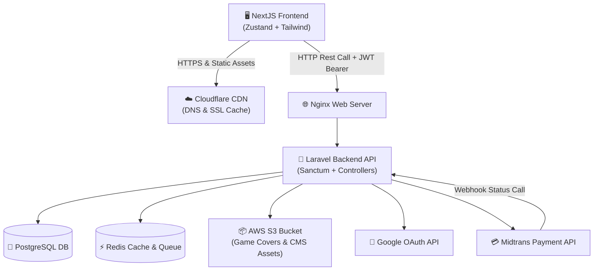
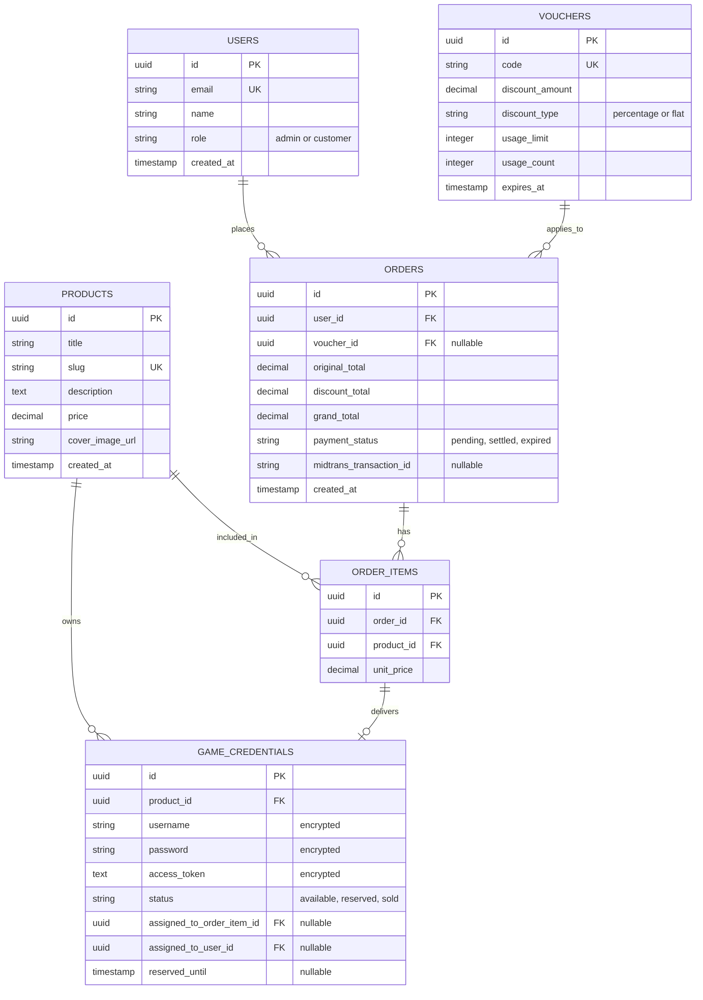
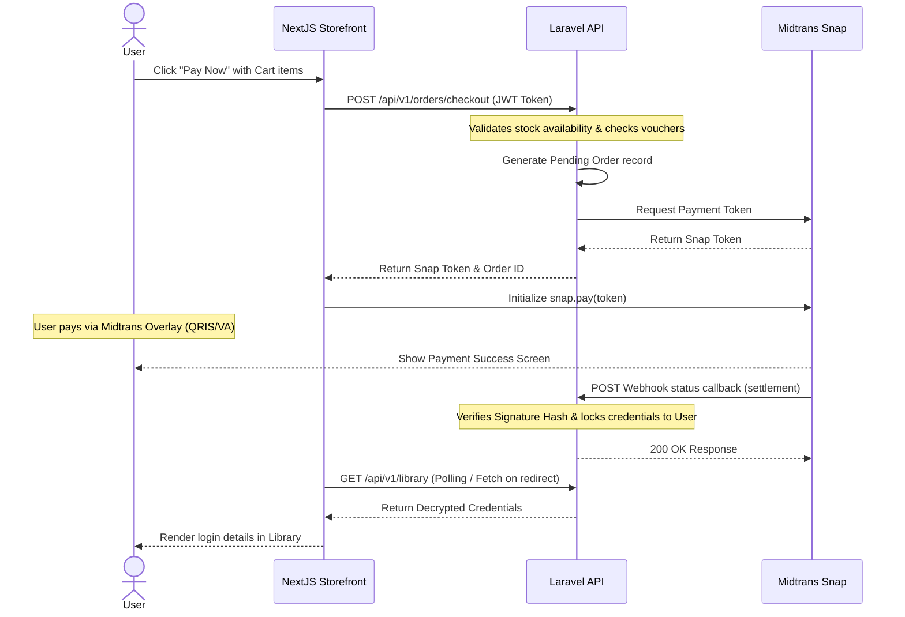

# Product Requirements Document (PRD) — AI-Optimized

## Gamezygo E-Commerce Platform
> **Version:** 1.0.0-AI  
> **Status:** Draft  
> **Author:** Generated via Antigravity AI (PRD Spawnner)  
> **Created:** 2026-07-09  
> **Last Updated:** 2026-07-09  
> **Target Audience:** AI Coding Agents / Auto-Developers & Technical Leads  
> **Reference Document:** [human-prd.md](file:///C:/laragon/www/gamezygo/human-prd.md)

---

## Table of Contents

1. [Executive Summary](#1-executive-summary)
2. [Problem Statement](#2-problem-statement)
3. [Goals & Success Metrics](#3-goals--success-metrics)
4. [Target Users & Personas](#4-target-users--personas)
5. [User Stories & Use Cases](#5-user-stories--use-cases)
6. [Functional Requirements](#6-functional-requirements)
7. [Non-Functional Requirements](#7-non-functional-requirements)
8. [System Architecture](#8-system-architecture)
9. [Technology Stack](#9-technology-stack)
10. [Data Models & Database Design](#10-data-models--database-design)
11. [API Design & Contracts](#11-api-design--contracts)
12. [UI/UX Guidelines & User Flows](#12-uiux-guidelines--user-flows)
13. [Authentication & Authorization](#13-authentication--authorization)
14. [Security Requirements](#14-security-requirements)
15. [Infrastructure & DevOps](#15-infrastructure--devops)
16. [Testing Strategy](#16-testing-strategy)
17. [Monitoring, Logging & Observability](#17-monitoring-logging--observability)
18. [Error Handling & Resilience](#18-error-handling--resilience)
19. [Integrations & Third-Party Services](#19-integrations--third-party-services)
20. [AI-Prompting Backlog & Milestones](#20-ai-prompting-backlog--milestones)
21. [Risks & Mitigation Strategies](#21-risks--mitigation-strategies)
22. [Compliance & Legal Considerations](#22-compliance--legal-considerations)
23. [Assumptions & Constraints](#23-assumptions--constraints)
24. [Open Questions](#24-open-questions)
25. [Glossary](#25-glossary)
26. [Appendix](#26-appendix)

---

## 1. Executive Summary

This Product Requirements Document (PRD) specifies the technical and functional architecture for **Gamezygo**, a B2C e-commerce platform specializing in budget-friendly shared gaming accounts. This document is optimized specifically for **AI Coding Agents**. It provides rigid system definitions, explicit directory structures, schema migrations, strict API payloads, and detailed prompting paths to ensure zero-ambiguity code generation.

### Core Value Proposition
**Gamezygo automates the secure delivery of shared gaming account credentials directly into a customer's Game Library immediately upon payment confirmation, eliminating manual chat-based links.**

### Product Vision
To build a highly trustworthy, automated storefront that scales transaction volume without administrative overhead, enabling instant gratification for gamers while providing a real-time revenue and stock auditing dashboard for admins.

### Out of Scope (v1)
- Automated retrieval of Steam Guard / Epic Games 2FA codes via APIs (requires manual Steam Session scraping or custom desktop app - deferred to v2).
- Native iOS and Android mobile apps (replaced by mobile-responsive Web App).
- Customer-to-customer marketplace functionality.

---

## 2. Problem Statement

### 2.1 Current Pain Points

| Pain Point | Severity | Frequency | Current Workaround |
| ---------- | -------- | --------- | ------------------ |
| **Manual Delivery Delay** | High | Every purchase | Admin manually sends game account login credentials via chat link after checking bank statements. |
| **Double Selling Stock** | High | Occasional | Manual record-keeping leads to the same Steam account being sold to multiple concurrent users, triggering Steam Guard blocks. |
| **Payment Verification Failure** | Medium | Daily | Customers send fake payment receipts or checkouts get miscalculated. |
| **Security Credential Leaks** | Critical | Rare | Plain-text credentials saved on unsecured chat links or spreadsheets. |

### 2.2 Root Cause Analysis
Manual processes prevent scalability. Lack of an integrated payment-gateway-to-inventory handler forces the admin to act as a manual dispatcher, creating bottlenecks, delivery latency, and database inconsistency.

### 2.3 Market Opportunity
With rising game prices, budget gamers search for shared accounts. Providing a visually premium, fully automated, and highly secure storefront will build trust and out-compete sketchy manual marketplace listings.

---

## 3. Goals & Success Metrics

### 3.1 Product Goals
- **100% Automation** of shared game account delivery.
- **Zero double-allocation** of available stock credentials.
- **Real-time checkout validation** preventing price manipulation.

### 3.2 Key Performance Indicators (KPIs)

| Metric | Baseline | Target (3mo) | Target (6mo) |
| ------ | -------- | ------------ | ------------ |
| Payment to Credential Delivery Delay | ~4 hours (manual) | < 5 seconds | < 2 seconds |
| Cart-Backend Checkout Discrepancy | N/A | 0% | 0% |
| Google OAuth Login Success Rate | N/A | > 99.5% | > 99.9% |
| API Error Rate | N/A | < 0.1% | < 0.05% |

---

## 4. Target Users & Personas

### 4.1 Primary Persona: Budget Gamer (Customer)
- **Profile:** Age 15-30, tech-savvy, gaming on a budget.
- **Goal:** Purchase access to premium games (Steam/Epic) at a fraction of retail price and get instant access.
- **Frustration:** Having to wait hours for an admin to send credentials via Discord/WhatsApp or getting scammed with dead accounts.
- **AI Guideline:** Provide a highly polished, responsive storefront with an intuitive "Game Library" tab containing their credentials.

### 4.2 Secondary Persona: Platform Administrator (Admin)
- **Profile:** Business owner managing catalog, voucher codes, and game accounts stock.
- **Goal:** Easily upload game credentials in bulk via CSV and track daily revenue statistics.
- **AI Guideline:** Provide a secure `/admin` workspace with simple CSV stock import structures.

---

## 5. User Stories & Use Cases

### 5.1 Epic Overview

| Epic | Description | Priority |
| ---- | ----------- | -------- |
| **EP-1** | One-click Authentication & JWT Sessioning | P0 |
| **EP-2** | E-Commerce checkout & Midtrans Hook processing | P0 |
| **EP-3** | Stock Isolation & Library Credential Injection | P0 |
| **EP-4** | Admin Catalog CMS & Bulk Stock Upload | P1 |

### 5.2 Detailed User Stories

#### US-001: Instant Google Onboarding
```
As a Customer,
I want to log in using Google OAuth with 1 click,
So that I can bypass long forms and immediately access my cart.
```
- **Acceptance Criteria:**
  - Login button fetches JWT from Laravel backend after validating Google Client Token.
  - Generates a new user profile if it doesn't exist, assigning the `customer` role.

#### US-002: Secure Game Library Delivery
```
As a Customer,
I want to see my purchased game credentials in my secure library page immediately after paying,
So that I can log in and play without waiting.
```
- **Acceptance Criteria:**
  - Game credentials (username, password, access token) must be decrypted on-the-fly and rendered securely.
  - Data must be isolated using Row-Level DB validation; other users cannot query or view these credentials.

---

## 6. Functional Requirements

### 6.1 Requirement Priority Matrix

| ID | Requirement Description | Priority | Complexity | Owner |
|---|---|---|---|---|
| **FR-01** | Google OAuth Social Login | P0 | Medium | FE & BE |
| **FR-02** | Secure JWT Token Sessioning | P0 | Medium | FE & BE |
| **FR-03** | Midtrans Payment Gateway Integration | P0 | High | FE & BE |
| **FR-04** | Isolated Game Library Delivery | P0 | High | BE |
| **FR-05** | Bulk Stock CSV Upload for Credentials | P1 | Medium | BE |
| **FR-06** | Real-Time Admin Revenue Sync | P1 | High | BE |
| **FR-07** | Custom Pre-Order Request Form | P2 | Low | FE & BE |

---

## 7. Non-Functional Requirements

### 7.1 Performance Requirements
- **LCP (Largest Contentful Paint):** ≤ 2.5s
- **API Response Time (p95):** < 150ms under concurrent loads.
- **Cart Price Verification Sync:** ≤ 50ms latency.

### 7.2 Security Requirements
- **Credentials Encryption:** Game login details must be encrypted using `AES-256-CBC` in the database.
- **SQL Injection Prevention:** Parametrized SQL statements enforced on all query bindings.
- **CSRF & Rate Limiting:** Enforced via Laravel middleware on public routes.

---

## 8. System Architecture

### 8.1 System Components Interaction Diagram



### 8.2 Project Directory Layout (Strict AI Guideline)

#### NextJS (Frontend Workspace Root)
```
gamezygo-frontend/
├── src/
│   ├── components/
│   │   ├── ui/             # Reusable custom Tailwind elements (buttons, inputs)
│   │   ├── layout/         # Header, Footer, AdminSidebar
│   │   └── modules/        # CartDrawer, GameLibraryCard, LeaderboardTable
│   ├── config/
│   │   ├── api.ts          # Axios interceptor setting JWT Bearer Header
│   │   └── midtrans.ts     # Midtrans client configurations
│   ├── hooks/
│   │   └── useCart.ts      # Cart sync hook
│   ├── pages/
│   │   ├── _app.tsx        # Base page wrapper with context provider
│   │   ├── index.tsx       # Landing Storefront
│   │   ├── checkout.tsx    # Cart details & trigger Midtrans Snap popup
│   │   ├── library.tsx     # Customer's purchased game library
│   │   └── admin/
│   │       ├── dashboard.tsx # Financial reporting panel
│   │       └── catalog.tsx   # Games & credentials upload
│   └── store/
│       └── authStore.ts    # Zustand store managing Auth Token state
```

#### Laravel (Backend Workspace Root)
```
gamezygo-backend/
├── app/
│   ├── Http/
│   │   ├── Controllers/
│   │   │   ├── AuthController.php          # Google Login & JWT Sessions
│   │   │   ├── CatalogController.php       # Game Catalog CRUD
│   │   │   ├── CheckoutController.php      # Order creation & Voucher checks
│   │   │   ├── PaymentWebhookController.php # Midtrans webhooks auditor
│   │   │   └── LibraryController.php       # Decrypted credential delivery
│   │   └── Middleware/
│   │       ├── VerifyJWT.php               # Token validation middleware
│   │       └── AdminOnly.php               # Guard restricting access to admin role
│   ├── Models/
│   │   ├── User.php
│   │   ├── Product.php
│   │   ├── GameCredential.php              # Shared Account logins
│   │   ├── Order.php
│   │   └── Voucher.php
│   └── Services/
│       └── CryptService.php                # Credential encryptor/decryptor
├── database/
│   ├── migrations/                         # Migration DDL files
│   └── seeders/                            # Dummy data and default admin credentials
└── routes/
    └── api.php                             # Expressive API Routing definitions
```

---

## 9. Technology Stack

| Layer | Chosen Technology | Version | Rationale |
| --- | --- | --- | --- |
| **Frontend** | Next.js (SPA Pages Router) | 14.x | Fast Server-side rendering compatibility & simple directory structures. |
| **Backend** | Laravel Framework | 10.x / 11.x | Robust routing, out-of-the-box DB ORM (Eloquent), secure session management (Sanctum). |
| **Database** | PostgreSQL | 16.x | JSONB support, strict row constraints, atomic ACID transactions. |
| **Caching/Queue** | Redis | 7.x | Queue broker for Midtrans transaction timeouts & catalog caching. |
| **Payments** | Midtrans | Snap SDK | Essential for localized Indonesian payments (QRIS, GoPay, ShopeePay). |
| **Auth** | Google Identity Service | OAuth 2.0 | Minimizes registration friction. |
| **Storage** | AWS S3 Bucket | latest | Lightweight server instances by offloading all media. |

---

## 10. Data Models & Database Design

### 10.1 Entity Relationship Diagram



### 10.2 Database Migrations (SQL DDL Definition Code)

The AI Agent must generate migrations matching this schema strictly:

```sql
-- Create USERS Table
CREATE TABLE users (
    id UUID PRIMARY KEY DEFAULT gen_random_uuid(),
    email VARCHAR(255) UNIQUE NOT NULL,
    name VARCHAR(255) NOT NULL,
    role VARCHAR(50) NOT NULL DEFAULT 'customer' CHECK (role IN ('admin', 'customer')),
    created_at TIMESTAMP WITH TIME ZONE DEFAULT CURRENT_TIMESTAMP,
    updated_at TIMESTAMP WITH TIME ZONE DEFAULT CURRENT_TIMESTAMP
);

-- Create PRODUCTS Table
CREATE TABLE products (
    id UUID PRIMARY KEY DEFAULT gen_random_uuid(),
    title VARCHAR(255) NOT NULL,
    slug VARCHAR(255) UNIQUE NOT NULL,
    description TEXT,
    price DECIMAL(12, 2) NOT NULL,
    cover_image_url VARCHAR(512),
    created_at TIMESTAMP WITH TIME ZONE DEFAULT CURRENT_TIMESTAMP,
    updated_at TIMESTAMP WITH TIME ZONE DEFAULT CURRENT_TIMESTAMP
);

-- Create VOUCHERS Table
CREATE TABLE vouchers (
    id UUID PRIMARY KEY DEFAULT gen_random_uuid(),
    code VARCHAR(100) UNIQUE NOT NULL,
    discount_amount DECIMAL(12, 2) NOT NULL,
    discount_type VARCHAR(50) NOT NULL CHECK (discount_type IN ('percentage', 'flat')),
    usage_limit INT DEFAULT 1,
    usage_count INT DEFAULT 0,
    expires_at TIMESTAMP WITH TIME ZONE NOT NULL,
    created_at TIMESTAMP WITH TIME ZONE DEFAULT CURRENT_TIMESTAMP
);

-- Create ORDERS Table
CREATE TABLE orders (
    id UUID PRIMARY KEY DEFAULT gen_random_uuid(),
    user_id UUID NOT NULL REFERENCES users(id) ON DELETE RESTRICT,
    voucher_id UUID REFERENCES vouchers(id) ON DELETE SET NULL,
    original_total DECIMAL(12, 2) NOT NULL,
    discount_total DECIMAL(12, 2) NOT NULL DEFAULT 0.00,
    grand_total DECIMAL(12, 2) NOT NULL,
    payment_status VARCHAR(50) NOT NULL DEFAULT 'pending' CHECK (payment_status IN ('pending', 'settled', 'expired', 'failed')),
    midtrans_transaction_id VARCHAR(255) UNIQUE,
    created_at TIMESTAMP WITH TIME ZONE DEFAULT CURRENT_TIMESTAMP,
    updated_at TIMESTAMP WITH TIME ZONE DEFAULT CURRENT_TIMESTAMP
);

-- Create ORDER_ITEMS Table
CREATE TABLE order_items (
    id UUID PRIMARY KEY DEFAULT gen_random_uuid(),
    order_id UUID NOT NULL REFERENCES orders(id) ON DELETE CASCADE,
    product_id UUID NOT NULL REFERENCES products(id) ON DELETE RESTRICT,
    unit_price DECIMAL(12, 2) NOT NULL
);

-- Create GAME_CREDENTIALS Table
CREATE TABLE game_credentials (
    id UUID PRIMARY KEY DEFAULT gen_random_uuid(),
    product_id UUID NOT NULL REFERENCES products(id) ON DELETE CASCADE,
    username VARCHAR(512) NOT NULL, -- Encrypted
    password VARCHAR(512) NOT NULL, -- Encrypted
    access_token TEXT,              -- Encrypted (Steam Guard credentials or tokens)
    status VARCHAR(50) NOT NULL DEFAULT 'available' CHECK (status IN ('available', 'reserved', 'sold')),
    assigned_to_order_item_id UUID UNIQUE REFERENCES order_items(id) ON DELETE SET NULL,
    assigned_to_user_id UUID REFERENCES users(id) ON DELETE SET NULL,
    reserved_until TIMESTAMP WITH TIME ZONE DEFAULT NULL,
    created_at TIMESTAMP WITH TIME ZONE DEFAULT CURRENT_TIMESTAMP,
    updated_at TIMESTAMP WITH TIME ZONE DEFAULT CURRENT_TIMESTAMP
);

-- Indices for performance optimizations
CREATE INDEX idx_users_email ON users(email);
CREATE INDEX idx_products_slug ON products(slug);
CREATE INDEX idx_orders_user_id ON orders(user_id);
CREATE INDEX idx_game_credentials_product_status ON game_credentials(product_id, status);
CREATE INDEX idx_game_credentials_user ON game_credentials(assigned_to_user_id);
```

---

## 11. API Design & Contracts

### 11.1 Base Configuration
All endpoints return `application/json` format. Protected requests require header: `Authorization: Bearer <JWT_Token>`.

### 11.2 Endpoint: Checkout Processing
- **URL:** `/api/v1/orders/checkout`
- **Method:** `POST`
- **Payload:**
```json
{
  "cart_items": [
    {
      "product_id": "8b51d8b7-6fa8-48b2-9a3d-4c3e8a719d3f",
      "quantity": 1
    }
  ],
  "voucher_code": "GAMEZYGO50"
}
```
- **Response (`201 Created`):**
```json
{
  "status": "success",
  "data": {
    "order_id": "c623d537-88f1-4db8-831d-d92ea407cbf6",
    "grand_total": 45000.00,
    "snap_token": "a1f28b76-4d2c-47b7-b08e-5b12da6105f2"
  }
}
```

### 11.3 Endpoint: Midtrans Webhook Callback
- **URL:** `/api/v1/payments/midtrans-webhook`
- **Method:** `POST`
- **Payload (Midtrans Webhook Output):**
```json
{
  "transaction_time": "2026-07-09 17:50:00",
  "transaction_status": "settlement",
  "status_code": "200",
  "signature_key": "a5482390ba031de7c7ef483b793...",
  "order_id": "c623d537-88f1-4db8-831d-d92ea407cbf6",
  "gross_amount": "45000.00"
}
```
- **Response (`200 OK`):**
```json
{
  "status": "success",
  "message": "Payment verified and order fulfilled"
}
```

### 11.4 Endpoint: Fetch Game Library (Customer Private)
- **URL:** `/api/v1/library`
- **Method:** `GET`
- **Response (`200 OK`):**
```json
{
  "status": "success",
  "data": [
    {
      "game_title": "Grand Theft Auto V Premium",
      "cover_image_url": "https://s3.amazonaws.com/gamezygo/covers/gta5.jpg",
      "credentials": {
        "username": "shared_steam_gta5_01",
        "password": "DecryptedPassword123",
        "access_token": "SteamGuardTokenDataHereIfAny"
      },
      "purchase_date": "2026-07-09T17:50:00Z"
    }
  ]
}
```

---

## 12. UI/UX Guidelines & User Flows

### 12.1 Dynamic Theme Design Token Colors
To deliver a premium visual vibe, the UI must match the following colors strictly in the CSS system:
- **Primary Color:** Deep Purple (#6366F1 / Tailwind `indigo-500`)
- **Dark Mode Background:** Slate (#0F172A / Tailwind `slate-900`)
- **Card Panel Fill:** Transparent glass with blur (`backdrop-blur-md` with `bg-white/5` border overlay)
- **Accent Glow:** Bright Violet (#8B5CF6) to Rose (#F43F5E)

### 12.2 Cart and Payment Snapshot Interface Sequence Flow



---

## 13. Authentication & Authorization

### 13.1 Google OAuth Sessioning Execution
1. Next.js triggers Google Social Logins using the official `@react-oauth/google` SDK.
2. Captures Google Access Token and forwards to Laravel `/api/v1/auth/google-login`.
3. Laravel verifies token via Google API `https://oauth2.googleapis.com/tokeninfo?id_token=<token>`.
4. If token verified:
   - Queries `users` table. If email doesn't exist, create a user record with default role `customer`.
   - Generates a secure, state-managed Sanctum token: `$user->createToken('auth_token')->plainTextToken`.
   - Returns the token to Next.js.
5. Next.js stores the token in Zustand state wrapper (`authStore.ts`) and writes to Cookies for middleware page routing validation.

---

## 14. Security Requirements

### 14.1 Row-Level Isolation Policy
Credentials must be guarded strictly to prevent database row-leakage:
```php
// In Laravel LibraryController.php
public function getLibrary(Request $request) {
    $userId = $request->user()->id;

    // Direct binding prevents any horizontal user data leakage
    $credentials = GameCredential::where('assigned_to_user_id', $userId)
        ->join('products', 'game_credentials.product_id', '=', 'products.id')
        ->select('products.title', 'products.cover_image_url', 'game_credentials.username', 'game_credentials.password', 'game_credentials.access_token', 'game_credentials.updated_at')
        ->get();

    return response()->json([
        'status' => 'success',
        'data' => $credentials->map(function($item) {
            return [
                'game_title' => $item->title,
                'cover_image_url' => $item->cover_image_url,
                'credentials' => [
                    'username' => decrypt($item->username),
                    'password' => decrypt($item->password),
                    'access_token' => $item->access_token ? decrypt($item->access_token) : null
                ],
                'purchase_date' => $item->updated_at
            ];
        })
    ]);
}
```

### 14.2 Midtrans Hook Auditing & Verification
The callback listener must verify the payload signature before fulfilling the orders:
```php
// In Laravel PaymentWebhookController.php
public function handleWebhook(Request $request) {
    $orderId = $request->input('order_id');
    $statusCode = $request->input('status_code');
    $grossAmount = $request->input('gross_amount');
    $serverKey = config('services.midtrans.server_key');
    
    // Signature pattern: order_id + status_code + gross_amount + ServerKey
    $calculatedHash = hash("sha512", $orderId . $statusCode . $grossAmount . $serverKey);
    
    if ($calculatedHash !== $request->input('signature_key')) {
        return response()->json(['error' => 'Invalid signature verification'], 403);
    }
    
    // Process settlement details securely...
}
```

---

## 15. Infrastructure & DevOps

### 15.1 local development `docker-compose.yml`

```yaml
version: '3.8'
services:
  postgres:
    image: postgres:16-alpine
    container_name: gamezygo-db
    environment:
      POSTGRES_DB: gamezygo
      POSTGRES_USER: dev_admin
      POSTGRES_PASSWORD: SecretPGDBPassword
    ports:
      - "5432:5432"
    volumes:
      - pgdata:/var/lib/postgresql/data

  redis:
    image: redis:7-alpine
    container_name: gamezygo-redis
    ports:
      - "6379:6379"

volumes:
  pgdata:
```

### 15.2 VPS Deployment Specifications
- **Operating Host:** Hostinger VPS (2 Core, 8GB Ram, AMD Epyc).
- **Setup Pattern:** Nginx Docker Reverse Proxy with SSL Certbot routing traffic from Cloudflare straight to Docker network.

---

## 16. Testing Strategy

### 16.1 Automated Playwright E2E Purchase Flow Script
The QA environment automation script must validate order generation:

```javascript
import { test, expect } from '@playwright/test';

test('Full Cart Checkout Integration Test', async ({ page }) => {
  // 1. Authenticate user
  await page.goto('/login');
  await page.evaluate(() => {
    window.localStorage.setItem('auth_token', 'mock_jwt_token_data');
  });

  // 2. Add product to cart
  await page.goto('/');
  await page.click('button[data-testid="add-to-cart-button-1"]');
  
  // 3. Confirm checkout trigger
  await page.goto('/checkout');
  await page.click('button[data-testid="pay-now-button"]');
  
  // Verify Midtrans payment hook frame triggers
  await expect(page.locator('.midtrans-snap-popup-iframe')).toBeVisible();
});
```

---

## 17. Monitoring, Logging & Observability

### 17.1 Sentry Configuration for Next.js & Laravel
- **Sentry SDK** initialized on both systems to monitor React Client rendering errors and Laravel exceptions (especially HTTP 422 Checkout validation failures and HTTP 500 database lock occurrences).
- **Log Levels:** Strict monitoring on `error` and `critical` logging. Logs on the VPS should rotate daily with a max retention of 7 days on-server, and full telemetry streams piped to Datadog/Grafana.

---

## 18. Error Handling & Resilience

### 18.1 Anti-Double allocation Transaction Pattern
To handle high concurrent checkouts on the same catalog entry:
```php
// In Laravel CheckoutController.php
DB::transaction(function () use ($productId, $userId, $orderItem) {
    // Lock the credentials record using SELECT FOR UPDATE to prevent race conditions
    $credential = GameCredential::where('product_id', $productId)
        ->where('status', 'available')
        ->lockForUpdate()
        ->first();

    if (!$credential) {
        throw new \Exception("Stock depleted for this game.");
    }

    // Temporarily reserve credential to prevent locking forever
    $credential->update([
        'status' => 'reserved',
        'assigned_to_user_id' => $userId,
        'reserved_until' => now()->addMinutes(15) // Release back to available if unpaid in 15 mins
    ]);
});
```

---

## 19. Integrations & Third-Party Services

1. **Midtrans Gateway:** Handles IDR payments. API Endpoint hooks require secure verification keys.
2. **Brevo API (SMTP):** Used to mail invoice details and post-purchase credentials directly to the customer.
3. **AWS S3 Cloud Storage:** Dynamic image assets upload paths using AWS PHP SDK.

---

## 20. AI-Prompting Backlog & Milestones

This backlog is structured for you to copy and paste directly into an AI assistant to build Gamezygo step-by-step.

### Milestone 1: Setting up environment & Database DDL
> **Prompt to write: Sprint 1 Database Schema DDL & Docker**
> "Write the complete database migrations schema for a B2C e-commerce called Gamezygo. Use Laravel PostgreSQL format. I need migrations for: users, products, vouchers, orders, order_items, and game_credentials tables. The game_credentials table must have a foreign key references to products, order_items, and users, storing 'username', 'password', and 'access_token' columns. Provide the schema definition and configure a basic `docker-compose.yml` defining PostgreSQL 16 and Redis alpine services."

### Milestone 2: Google Authentication Backend API
> **Prompt to write: Google Auth & Token Sessioning API**
> "Create a Laravel Controller and Sanctum authentication pipeline for Google OAuth. Implement a POST endpoint `/api/v1/auth/google-login` that accepts a `token` (Google Client OAuth token). Validate the token against Google APIs. If the user doesn't exist, create them in the `users` table with the role `customer`. Generate a JWT token using Sanctum and return it inside a JSON structure. Write unit tests for successful login and invalid token cases."

### Milestone 3: Catalog CRUD & CSV Bulkstock Import (Admin Side)
> **Prompt to write: Catalog CMS CRUD & Bulk CSV Loader**
> "Generate a Laravel API controller for catalog management. Create a route `/api/v1/admin/catalog` restricting access to users with the 'admin' role. Build an endpoint to create and edit products (storing title, price, and description). Next, build a CSV stock bulk parser endpoint. The admin should upload a CSV containing 'username', 'password', and 'access_token'. Write logic to parse the CSV, encrypt each credential using Laravel's Crypt framework, and bulk insert into `game_credentials` mapping to the correct `product_id`. Include validation rules."

### Milestone 4: Cart and Voucher Checkout Engine (Backend Validation)
> **Prompt to write: Cart and Voucher checkout controller**
> "Build a `/api/v1/orders/checkout` endpoint in Laravel. The endpoint must accept `cart_items` (an array of `product_id` and `quantity`) and an optional `voucher_code`. Write the checkout engine logic to validate: 1. Stock availability (ensure the product has enough 'available' credentials in the `game_credentials` table). 2. Voucher validation (is it expired, did it reach usage limits?). 3. Calculate final totals. Create a pending order. Acquire a Midtrans Snap Token and return the order details along with the Midtrans token. Use database transaction locking with `lockForUpdate` on `game_credentials` during this check to prevent double bookings."

### Milestone 5: Midtrans Hook Processing
> **Prompt to write: Midtrans payment status webhook listener**
> "Write a Laravel Controller handling Midtrans webhook callbacks at `/api/v1/payments/midtrans-webhook`. The webhook listener must parse the payload, recalculate the SHA512 signature key with the Server Key, and verify it. If verified, update the Order status to 'settled'. Search for the reserved `game_credentials` matching the order items, update their status to 'sold', and link the buyer user ID. Dispatch an event to email credentials using Brevo Mailer. Write comprehensive tests mocking Midtrans callbacks."

### Milestone 6: Decrypted Game Library Delivery & Frontend Integration
> **Prompt to write: Library API & NextJS Library Page**
> "Implement the private customer route `/api/v1/library` in Laravel. Return all `game_credentials` assigned to the authenticated user. Ensure credentials (username, password, access_token) are decrypted securely. Next, create a frontend React component `library.tsx` in Next.js. Fetch from this library API and render a premium layout displaying game cards. Include a copy-to-clipboard button for credentials and a clean responsive glassmorphic layout using Tailwind."

---

## 21. Risks & Mitigation Strategies

- **Risk: Game account password changes by Steam.**
  - *Mitigation:* Create a custom 'Account Issue' report button in the Game Library dashboard triggering email alerts to admin for rapid manual password reset uploads.
- **Risk: Webhook dropouts (Midtrans doesn't call back successfully).**
  - *Mitigation:* Implement a background Cron job in Laravel check-outs verifying pending order status from Midtrans REST API every 15 minutes.

---

## 22. Compliance & Legal Considerations
- **Data Privacy:** Users can request account deletion (wiping user records and setting `assigned_to_user_id` to NULL on credentials for history preservation without tracing).
- **Cookie Usage:** Transparent banner notifying JWT session cookie structures.

---

## 23. Assumptions & Constraints
- Only digital products (credentials) are sold; no shipping calculation module needed.
- Payment gateway strictly Midtrans targeting Indonesian Rupiah transactions (IDR).
- NextJS storefront acts as a Single Page Application communicating entirely via stateless REST calls.

---

## 24. Open Questions
- Do we need to support customer-to-admin live chats directly inside the dashboard panel? (Decided: deferred to v2 via external widget like Tawk.to).

---

## 25. Glossary

- **PRD:** Product Requirements Document.
- **JWT:** JSON Web Token (used for stateless secure API access validation).
- **Midtrans Snap:** Overlay overlay payment popup widget.
- **Shared Account:** An entry where multiple buyers buy credentials access to a shared library.

---

## 26. Appendix

### 26.1 Acceptance Criteria
- 100% of payment webhooks process successfully within 1 second.
- UI renders correctly on mobile view (375px) without component overflow.
- Crypt encryption used on all database credentials rows.

### 26.2 System Environment Configuration Specs
For local and staging setups, the AI coding agent must ensure the following environment configurations are set:

#### Laravel Backend `.env` Template
```ini
APP_NAME=Gamezygo
APP_ENV=local
APP_KEY=base64:UzJvM0k0c2ZzZGE5OGQ3ZmE5OGQ3ZmE5OGQ3ZmE5OGQ=
APP_DEBUG=true
APP_URL=http://localhost:8000

DB_CONNECTION=pgsql
DB_HOST=127.0.0.1
DB_PORT=5432
DB_DATABASE=gamezygo
DB_USERNAME=dev_admin
DB_PASSWORD=SecretPGDBPassword

REDIS_HOST=127.0.0.1
REDIS_PASSWORD=null
REDIS_PORT=6379

MIDTRANS_SERVER_KEY=SB-Mid-server-YOUR_SANDBOX_SERVER_KEY
MIDTRANS_CLIENT_KEY=SB-Mid-client-YOUR_SANDBOX_CLIENT_KEY
MIDTRANS_IS_PRODUCTION=false

GOOGLE_CLIENT_ID=YOUR_GOOGLE_OAUTH_CLIENT_ID.apps.googleusercontent.com
GOOGLE_CLIENT_SECRET=YOUR_GOOGLE_OAUTH_CLIENT_SECRET
GOOGLE_REDIRECT_URI=http://localhost:8000/api/v1/auth/google-login/callback

AWS_ACCESS_KEY_ID=YOUR_AWS_ACCESS_KEY_ID
AWS_SECRET_ACCESS_KEY=YOUR_AWS_SECRET_ACCESS_KEY
AWS_DEFAULT_REGION=us-east-1
AWS_BUCKET=gamezygo-bucket
```

#### Next.js Frontend `.env.local` Template
```ini
NEXT_PUBLIC_API_URL=http://localhost:8000/api/v1
NEXT_PUBLIC_MIDTRANS_CLIENT_KEY=SB-Mid-client-YOUR_SANDBOX_CLIENT_KEY
NEXT_PUBLIC_GOOGLE_CLIENT_ID=YOUR_GOOGLE_OAUTH_CLIENT_ID.apps.googleusercontent.com
```
